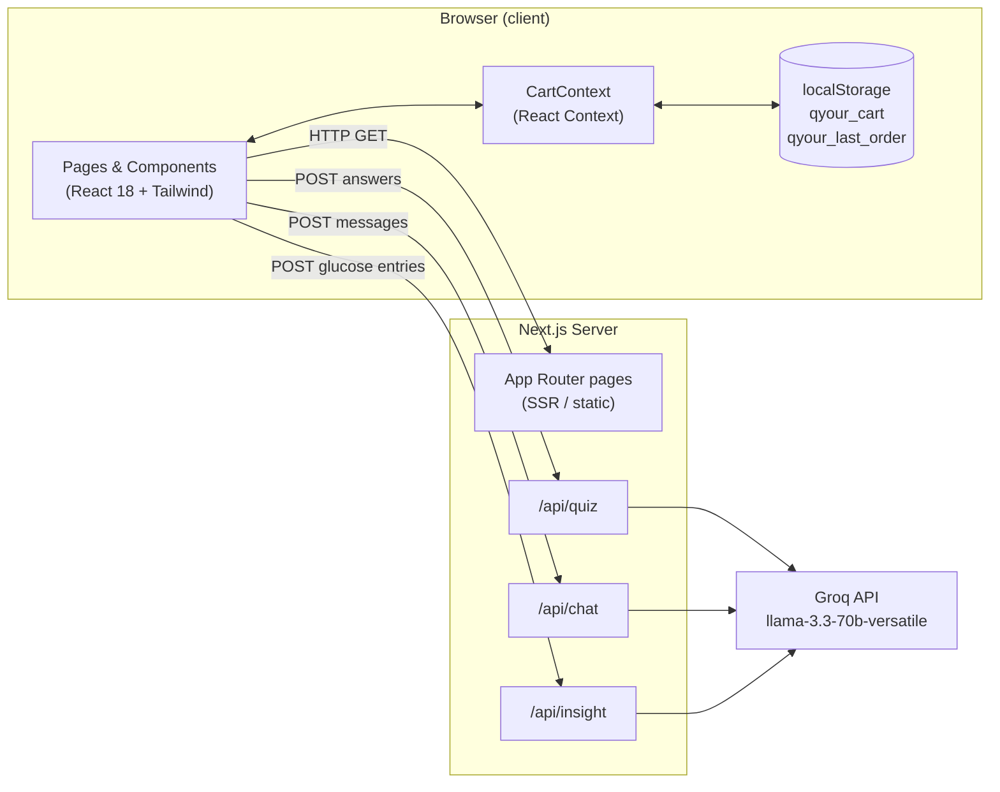
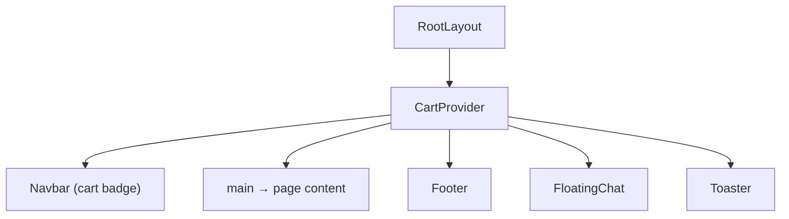
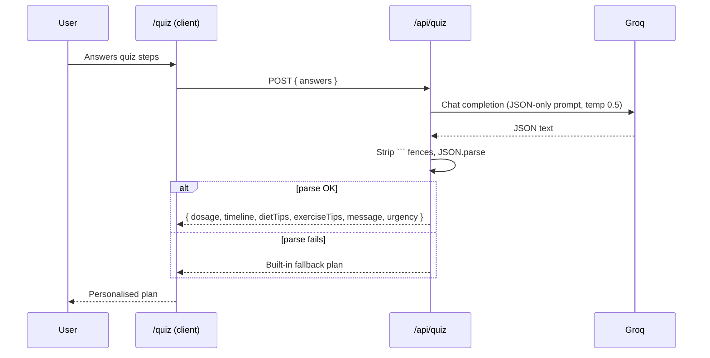
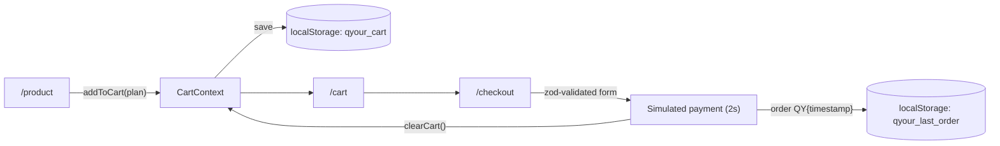

# QYOUR Architecture

This document explains how the QYOUR website is put together: its layers, how data moves through it, and where each piece of logic lives.

## 1. High-level overview

QYOUR is a single **Next.js 14 App Router** application. It contains no separate backend service and no database.

- **Pages** are React components, rendered on the server where possible.
- **Interactive pages** (quiz, cart, checkout, dashboard and forms) are client components.
- **AI features** use three server-side API routes, which call the **Groq API** (`llama-3.3-70b-versatile`).
- **Browser state** (the cart and the last order) is kept in `localStorage` through React Context.

## 2. Layers

| Layer          | Location                 | Responsibility                                             |
| -------------- | ------------------------ | ---------------------------------------------------------- |
| Root layout    | `app/layout.tsx`         | Fonts (Playfair Display, Inter), SEO metadata, global shell |
| Pages          | `app/**/page.tsx`        | One folder per route                                       |
| API routes     | `app/api/*/route.ts`     | Server-only calls to Groq; hold the secret key             |
| Shared UI      | `components/`            | Navbar, Footer, FloatingChat, AddToCartButton, Toaster     |
| State          | `context/CartContext.tsx`| Cart state, kept in `localStorage`                         |
| Domain data    | `lib/plans.ts`           | Subscription plans and prices (single source of truth)     |
| Utilities      | `lib/utils.ts`           | Helpers such as `cn()` for merging class names             |
| Styling        | `app/globals.css`, `tailwind.config.ts` | Design tokens and Tailwind theme            |

### Component tree

`FloatingChat` and `Toaster` are mounted once in the root layout, so they are available on every page.

## 3. Routes

| Route              | Type   | Notes                                              |
| ------------------ | ------ | -------------------------------------------------- |
| `/`                | Server | Landing page                                       |
| `/product`         | Server | Plans from `lib/plans.ts`, with `AddToCartButton`  |
| `/cart`            | Client | Reads `CartContext`                                |
| `/checkout`        | Client | Form checked with zod; payment is simulated (demo) |
| `/quiz`            | Client | Multi-step quiz that calls `/api/quiz`             |
| `/dashboard`       | Client | Glucose chart (Chart.js); calls `/api/insight`     |
| `/doctor-booking`  | Client | Booking form (simulated; nothing is sent)          |
| `/contact`         | Client | Contact form (simulated; nothing is sent)          |
| `/about`, `/how-it-works`, `/clinical-study`, `/blog`, `/faq` | Server | Content pages |
| `/privacy`, `/terms`, `/refund` | Server | Legal pages                       |

## 4. Key flows

### 4.1 AI quiz → personalised plan

### 4.2 Chat assistant

- `FloatingChat` keeps the conversation in component state and sends the full message history to `/api/chat`.
- The route adds a server-side **system prompt** (brand facts, tone and safety rules such as "never diagnose or prescribe"). Any `system` messages sent by the client are dropped.
- It returns `{ reply }`. If Groq fails, it returns a fixed fallback message.

### 4.3 Dashboard insights

- `/dashboard` starts with demo glucose readings, which are held in memory only. Users can add fasting and post-meal readings.
- The page sends `{ entries }` to `/api/insight`. Groq writes a 2–3 sentence encouraging insight, and a fallback message is used on failure.

### 4.4 Cart → checkout

The cart holds **one plan at a time**, so `cartCount` is either 0 or 1.

## 5. AI integration details

| Route          | Input           | Temperature | Max tokens | Output                  |
| -------------- | --------------- | ----------- | ---------- | ----------------------- |
| `/api/quiz`    | `{ answers }`   | 0.5         | 1024       | Structured JSON plan    |
| `/api/chat`    | `{ messages }`  | 0.7         | 512        | `{ reply }`             |
| `/api/insight` | `{ entries }`   | 0.6         | 256        | `{ insight }`           |

All three routes:
- call `https://api.groq.com/openai/v1/chat/completions` using `GROQ_API_KEY`, which **only exists on the server**
- return a sensible **fallback** if the model fails, so the page still shows something

## 6. Configuration

| Variable              | Required | Used by                    |
| --------------------- | -------- | -------------------------- |
| `GROQ_API_KEY`        | Yes      | All `/api/*` routes        |
| `RAZORPAY_KEY_ID`     | No       | Reserved for real payments |
| `RAZORPAY_KEY_SECRET` | No       | Reserved for real payments |

Put these in `.env.local`. Git ignores this file, so it is never committed.

## 7. Current limitations and next steps

| Area              | Current state                         | Suggested next step                              |
| ----------------- | ------------------------------------- | ------------------------------------------------ |
| Payments          | Simulated in the browser              | Razorpay order API, plus server-side signature check |
| Orders and bookings | `localStorage` / not saved          | Add a database (e.g. Postgres/Supabase)          |
| Contact form      | Simulated                             | Email service (e.g. Resend) or CRM               |
| Dashboard data    | In memory, starts from demo data      | Save readings for each user (needs auth)         |
| Auth              | None                                  | Add sign-in (e.g. NextAuth / Clerk)              |
| API protection    | No rate limiting                      | Add a rate limit to `/api/*` to protect the Groq quota |
| AI output         | Quiz JSON is parsed but not validated | Check the quiz response against a zod schema     |
